<p align="center">
  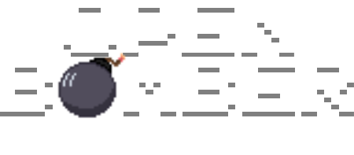
</p>

<p align="center">
  <b>Бесплатный мультиплеерный Bomberman прямо в браузере</b><br>
  одна общая арена до 32 игроков, боты, телефон и геймпад
</p>

<p align="center">
  <a href="https://openbomber.ru"><b>▶ Играть на openbomber.ru</b></a>
  &nbsp;·&nbsp; <a href="https://discord.gg/JzapKXFqzt">Discord</a>
  &nbsp;·&nbsp; <a href="https://t.me/gameopenbomber">Telegram</a>
  &nbsp;·&nbsp; <a href="https://vk.com/openbomber">VK</a>
  &nbsp;·&nbsp; <a href="https://www.youtube.com/@OpenBomber">YouTube</a>
  &nbsp;·&nbsp; <a href="https://boosty.to/vic_dev">Boosty</a>
</p>

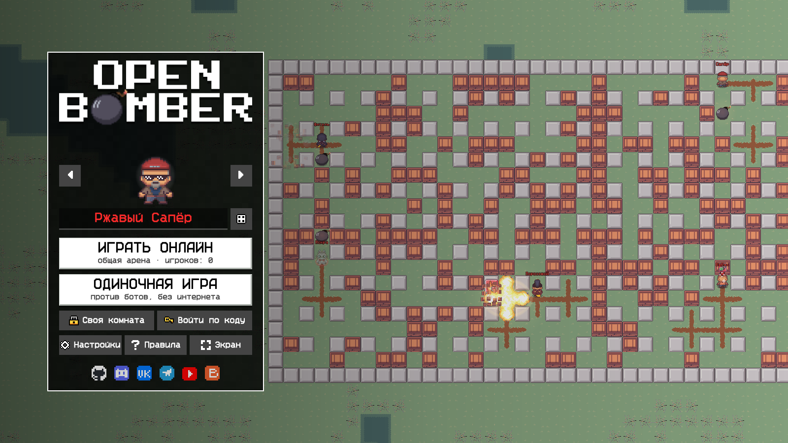

## Об игре

Заходишь на сайт и сразу попадаешь на живую общую арену. Можно смотреть, а можно нажать
**«Подключиться»** и играть со всеми. Карта растёт вместе с числом игроков: от 13×13 для одного
до 75×75 для 32. Вокруг арены лежит бесконечная трава.

Ставь бомбы, ломай кирпичи, собирай бусты и оставайся последним живым. Раунды идут без лобби:
когда в живых остаётся один, через 5 секунд начинается новая карта. Если раунд затягивается,
поле сужается кольцами: края по очереди превращаются в стены.

- **Онлайн.** Одна общая арена, приватные комнаты по коду или ссылке, наблюдатели, чат.
- **Одиночная игра.** До 7 ботов трёх уровней сложности, работает без интернета.
- **Где угодно.** Клавиатура, геймпад или тач-джойстик на телефоне, с вибрацией.

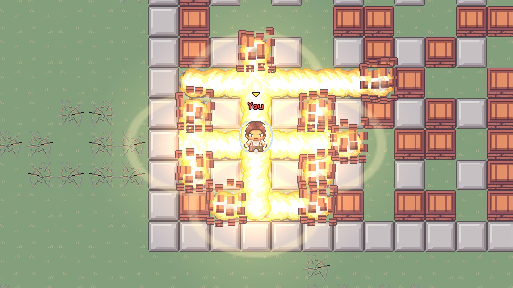

## Управление

| Действие | Клавиатура | Геймпад | Телефон |
|---|---|---|---|
| Движение | `WASD` / стрелки | левый стик / крестовина | плавающий джойстик слева |
| Бомба | `Space` / `Enter` | `A` | кнопка с бомбой |
| Действие (схватить, бросить, ударить, взорвать) | `E` / `Shift` / `J` | `B` / `X` | кнопка с ладонью |
| Чат | `T` | — | кнопка чата |
| Таблица игроков | зажать `Tab` | — | в меню |
| Меню | `Esc` | `Start` | `☰` |

Персонажи толкают друг друга, а коллизия мягкая: в коридоры легко зайти с угла.

## Бусты

Бусты выпадают из кирпичей. Временные складываются по времени, если подобрать ещё раз.

| | Буст | Что делает | Время |
|:---:|---|---|:---:|
| 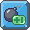 | **+бомба** | Можно поставить на одну бомбу больше | до конца раунда |
|  | **+радиус** | Взрыв на клетку дальше | до конца раунда |
|  | **Максимум огня** | Сразу максимальный радиус | до конца раунда |
| 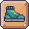 | **+скорость** | Бег ×1.5, гасит «огонь» | 25 с |
| 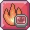 | **Огонь** | Медленнее (×0.7), но касание убивает соперника | 25 с |
| 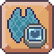 | **Щит** | Спасает от одного взрыва | 50 с |
| 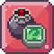 | **Шальная бомба** | Фитиль от 0.5 до 5 с, радиус до ×5, шанс 10% не взорваться | 30 с |
| 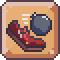 | **Пинок** | Бомба катится, пока не упрётся | 35 с |
| 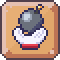 | **Перчатка** | Схватить бомбу и перебросить через стены и кирпичи | 35 с |
| 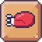 | **Удар** | Отбить бомбу перед собой на 3 клетки | 35 с |
| 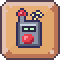 | **Детонатор** | Свои бомбы взрываются по кнопке «Действие» | 30 с |
| 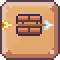 | **Пробивной огонь** | Огонь проходит сквозь кирпичи | 30 с |
| 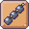 | **Линия бомб** | Встань на свою бомбу и нажми «Бомба»: все остальные лягут в ряд | 35 с |
| 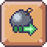 | **Сквозь бомбы** | Ходишь сквозь бомбы | 30 с |
|  | **Призрак** | Ходишь сквозь кирпичи | 30 с |
|  | **Сердце** | Дополнительная жизнь | до конца раунда |
|  | **Череп** | Случайное проклятие, которое передаётся касанием | 15 с |
|  | **Случайный** | Любой буст из списка | — |

Проклятия черепа: инверсия управления, бомбы сыплются сами, нельзя ставить бомбы, замедление,
неуправляемое ускорение, крошечный радиус.

## Герои


## Скриншоты

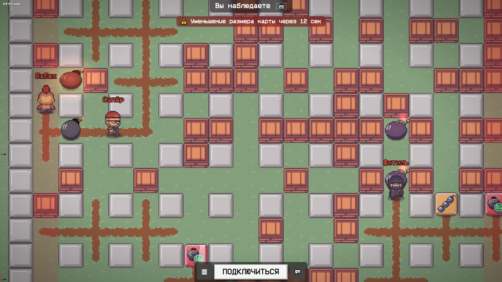

<p align="center">
  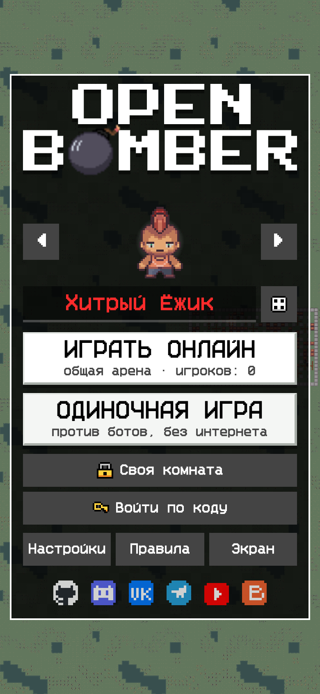
  &nbsp;&nbsp;
  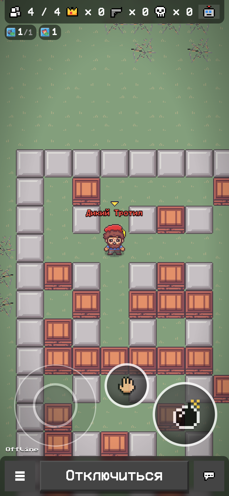
</p>

<details>
<summary>Как выглядела первая версия</summary>

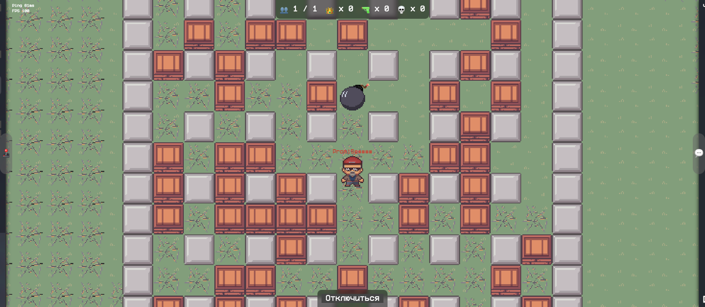
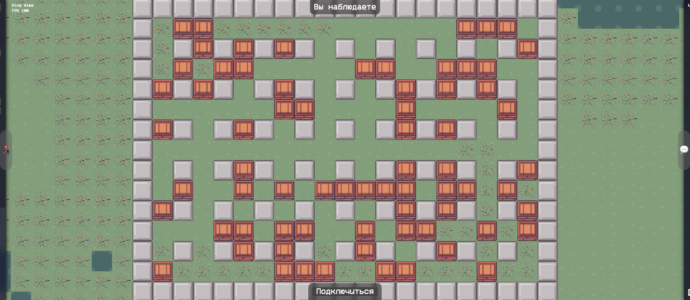

</details>

## Разработка

Монорепо на [Bun](https://bun.sh):

| Пакет | Что внутри |
|---|---|
| [`packages/game`](packages/game) | Детерминированная симуляция (60 Гц) и боты, общие для сервера и клиента |
| [`packages/server`](packages/server) | Авторитетный сервер на [Colyseus](https://colyseus.io): комнаты, синхронизация, античит |
| [`packages/client`](packages/client) | Рендер на [Pixi.js v8](https://pixijs.com), интерфейс на Preact, процедурные звуки, ввод |

Сервер считает всю игру сам. Клиент присылает только ввод: своё движение он предсказывает
тем же кодом симуляции, а чужих игроков интерполирует. Тот же код запускает одиночную игру
прямо в браузере.

```bash
bun install
bun run dev:server   # игровой сервер на ws://localhost:2567
bun run dev:client   # клиент на http://localhost:8080 (с ?mock интерфейс работает без сервера)
bun run test         # тесты симуляции и сервера
bun run build        # packages/client/dist и Node-бандл сервера в packages/server/dist
```

Стенды разработки: `/render/dev.html` (рендер на локальной симуляции с ботами)
и `/audio/dev.html` (все звуки).

<details>
<summary>Переменные окружения сервера</summary>

| Переменная | По умолчанию | |
|---|---|---|
| `PORT` | `2567` | Порт |
| `HOST` | все интерфейсы | Адрес |
| `BASE_PATH` | `/api` | Префикс, который тоже принимается (за nginx) |
| `MAX_CLIENTS` | `200` | Подключений на комнату (игроки и зрители) |
| `MAX_CLIENTS_PER_IP` | `6` | Подключений с одного IP |
| `MAX_ROOMS` | `300` | Комнат одновременно |
| `BOTS_MAIN` | `0` | Ботов в общей арене, пока там один человек |

Клиент в проде берёт путь до сервера из `VITE_SERVER_PATH` при сборке (по умолчанию `/api`).
За nginx нужен `proxy_set_header X-Real-IP $remote_addr;`, на нём держатся лимиты по IP.

</details>

Первая версия игры сохранена в истории git под тегом `v1`.

## Поддержать

Проект можно поддержать на [Boosty](https://boosty.to/vic_dev). Новости и общение в
[Discord](https://discord.gg/JzapKXFqzt), [Telegram](https://t.me/gameopenbomber) и
[VK](https://vk.com/openbomber).

## Лицензия

[GPL-3.0](LICENSE.md)
